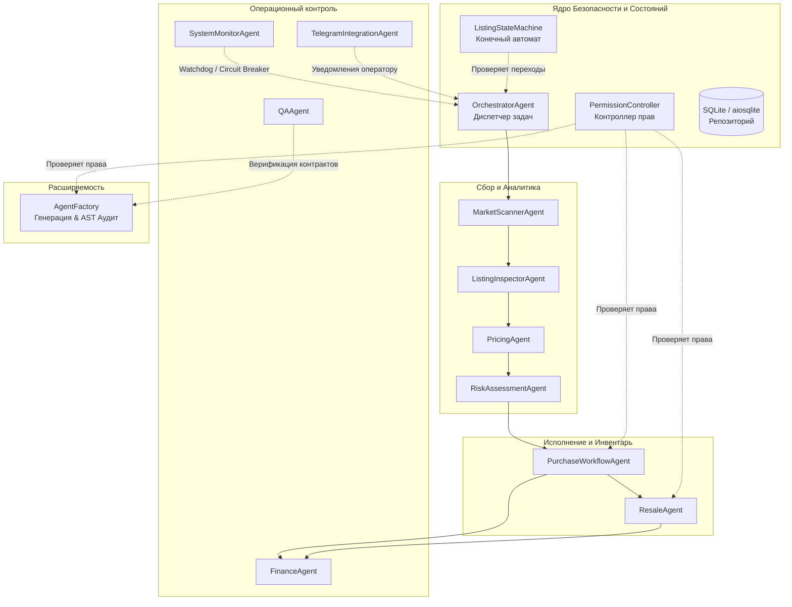

# Архитектура LZT Market Multi-Agent Arbitrage System

## 1. Концепция и цели

**LZT Market Multi-Agent Arbitrage System** — это модульная распределённая система на Python 3.12+ для мониторинга, глубокой оценки, расчёта арбитражной доходности и автоматизации разрешённых торговых операций с Telegram-аккаунтами на платформе LZT Market.

В основу архитектуры положены принципы:
1. **Детерминизм критических операций:** Все расчёты доходности, комиссий, ROI и бюджета производятся исключительно детерминированным Python-кодом с использованием `Decimal`. Языковые модели не принимают неконтролируемых финансовых решений.
2. **Принцип наименьших привилегий (RBAC):** Каждый агент имеет строго изолированный контекст безопасности (`SecurityContext`) и фиксированный набор разрешений (`Permission`).
3. **Недоверенность входных данных:** Заголовки и описания лотов на маркете рассматриваются как враждебный ввод с защитой от Prompt Injection атак.
4. **Идемпотентность и защита от повторных покупок:** Любая попытка повторного исполнения одной и той же сделки блокируется на уровне транзакционного сервиса и конечного автомата.
5. **Безопасная фабрика агентов (AgentFactory):** Автоматическая генерация новых специализированных агентов проверяется через статический анализ AST, изолированные тесты в `QAAgent` и снабжена механизмом отката.

---

## 2. Архитектурная схема компонентов



---

## 3. Система контроля доступа (RBAC)

Разрешения (`core/permissions.py`) не могут быть обойдены агентами или подделаны через LLM:

| Разрешение | Назначение | Доверенные агенты |
|---|---|---|
| `SCAN_MARKET` | Запрос каталога и поиск лотов | `MarketScannerAgent` |
| `INSPECT_LISTING` | Синтаксический и семантический разбор | `ListingInspectorAgent` |
| `CALCULATE_PRICING` | Оценка рыночной стоимости и расчет ROI | `PricingAgent` |
| `ASSESS_RISK` | Оценка рисков и право вето | `RiskAssessmentAgent` |
| `EXECUTE_PURCHASE` | Финансовое исполнение закупки | `PurchaseWorkflowAgent` (СТРОГО ОГРАНИЧЕНО) |
| `PUBLISH_RESALE` | Публикация лотов на продажу | `ResaleAgent` |
| `NOTIFY_TELEGRAM` | Отправка сообщений в Telegram бот | `TelegramIntegrationAgent` |
| `FINANCIAL_LEDGER` | Запись и аудит проводок баланса | `FinanceAgent` |
| `SYSTEM_MONITOR` | Пинг API и управление аварийным выключателем | `SystemMonitorAgent` |
| `RUN_QA` | Запуск регрессионного тестового стенда | `QAAgent` |

### Ограничения для динамических агентов:
Новые агенты, создаваемые через `AgentFactory`, **ни при каких условиях** не могут получить права `EXECUTE_PURCHASE`, `PUBLISH_RESALE` или доступ к секретам. Допустимы только аналитические разрешения (`SCAN_MARKET`, `INSPECT_LISTING`, `CALCULATE_PRICING`, `ASSESS_RISK`, `SYSTEM_MONITOR`, `RUN_QA`).

---

## 4. Контракт сообщений (`AgentMessage`)

Межагентное взаимодействие стандартизировано с помощью Pydantic:

```python
class AgentMessage(BaseModel, Generic[TInput, TOutput]):
    task_id: str
    agent_id: str
    task_type: str
    status: TaskStatus  # PENDING, RUNNING, SUCCESS, FAILED, BLOCKED
    input_data: TInput
    output_data: Optional[TOutput]
    errors: List[str]
    created_at: datetime
    completed_at: Optional[datetime]
    metadata: Dict[str, Any]
```

Каждое выполнение фиксируется в таблице базы данных `agent_logs` с замером времени выполнения в миллисекундах и трассировкой ошибок.
