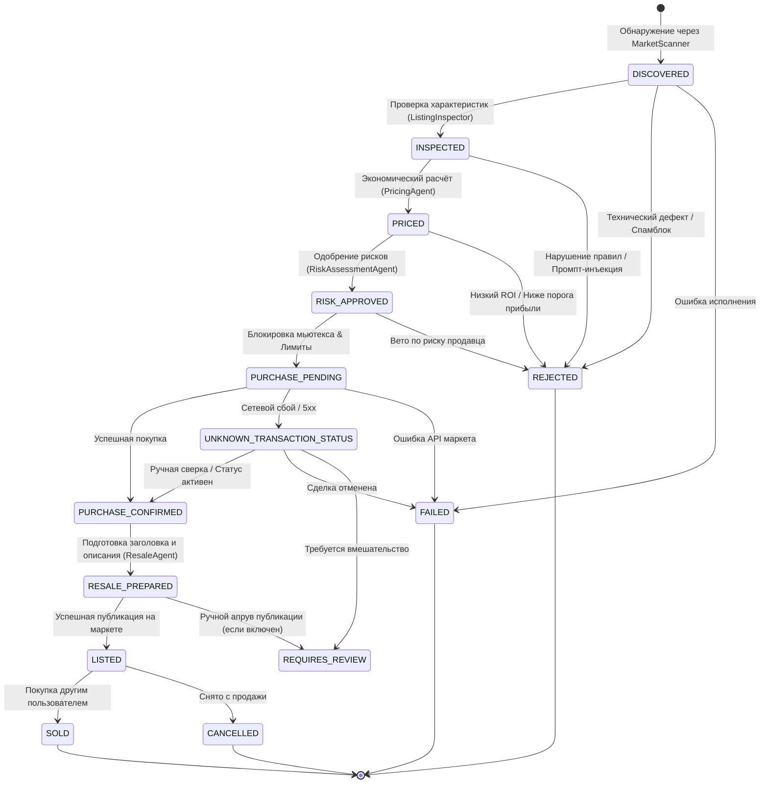

# Рабочий процесс и Конечный Автомат (Workflow FSM)

## 1. Схема жизненного цикла лота

Каждое найденное объявление проходит строгий конечный автомат состояний (`ListingStateMachine`):

---

## 2. Гарантии целостности переходов

1. **Невозможность пропуска этапов:** Попытка прямого перехода из `DISCOVERED` в `PURCHASE_PENDING` вызывает немедленное исключение `InvalidStateTransitionError`.
2. **Терминальные состояния:** Состояния `REJECTED`, `SOLD`, `FAILED` и `CANCELLED` являются терминальными; из них невозможно перевести лот в активные фазы без явного создания нового цикла.
3. **Обработка неоднозначности (`UNKNOWN_TRANSACTION_STATUS`):**
   - Если во время вызова метода `fast-buy` произошёл сетевой тайм-аут, обрыв сокета или HTTP 500/502/504, система категорически **запрещает немедленный повторный запрос**.
   - Лот помечается как `UNKNOWN_TRANSACTION_STATUS`.
   - Система выполняет предварительный вызов `check_item_status` или ожидает подтверждения статуса на стороне баланса, исключая списание средств за две покупки одного лота.
